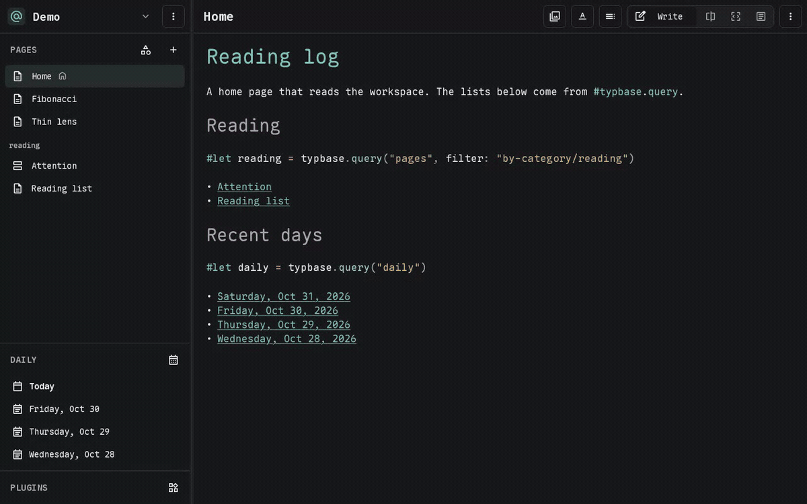

# Typbase

Local-first knowledge base made for [Typst](https://typst.app) and the [Atmosphere](https://atproto.com/).

[](https://github.com/user-attachments/assets/73947cb2-b571-4d00-b01e-5e09c0a17465)

## Features

- **Inline WYSIWYG:** Compiled output replaces the source as you type, with split and read views beside it.
- **Workspace queries:** `#typbase.query` reads pages, categories, daily notes, backlinks, and sections, and `#typbase.page-link` links any page by id.
- **Notebook pages:** `//%` lines split a page into prose, code, log, and hidden cells.
- **Plugins in Typst:** Sidebar widgets, panes, and floating windows written in the same language as your notes.
- **Local-first:** OPFS or native storage, content-addressed media, and optional atproto sync, collaboration, page posts, and site publishing.
- **Portable output:** Export HTML, PDF, SVG, or a compilable Typst project with the library, data, and plugins it needs.

## What is Typst and the Atmosphere?

**[Typst](https://typst.app)** is a document language. You write plain text with markup, math, and small programs, and Typst compiles it into PDF or HTML. Typbase treats a note as a Typst document, so pages, queries, math, exports, and plugin interfaces all share the same language.

**The [Atmosphere](https://atproto.com)** is an open network of accounts and apps built on the AT Protocol. Your account is portable instead of belonging to one app. Its data lives in a personal data server (PDS) that authorized apps can read or write, so Typbase's sync, publishing, and plugins travel with your account rather than one installation.

## Installation

You can download the latest version of the application from the [GitHub Release page](https://github.com/lemueldls/typbase/releases/latest).

### Windows (winget)

Run the following command:

```sh
winget install typbase
```

### Arch Linux (AUR)

Install either the prebuilt package or build-from-source package from AUR:

```sh
# Prebuilt binary package
paru -S typbase-bin

# Or build from source
paru -S typbase
```

### Void Linux

Add the repository and install the package:

```sh
# Add the repository
echo "repository=https://github.com/lemueldls/typbase/releases/latest/download" | sudo tee /etc/xbps.d/typbase-repo.conf

# Install the package
sudo xbps-install -S typbase
```

### Android

Download the APK from the [GitHub Release page](https://github.com/lemueldls/typbase/releases/latest).

Most phones use `arm64-v8a`, older 32-bit devices use `armeabi-v7a`, and emulators use `x86` or `x86_64`.

## Updating

- **Desktop:** Checks at launch and from the "General" settings, installs in place, and restarts.
- **AUR, Void, Nix:** These update through your package manager.
- **Android APK:** Downloads the build for your device's ABI, verifies its checksum, and opens the system installer. Android asks you to allow installs from the browser or file manager that opens the APK. Typbase asks for the "install unknown apps" permission once, the first time it installs its own update.

<!-- - **Google Play:** Play handles the download and the in-app prompt. -->
<!-- - **Obtainium:** Point it at the [GitHub repository](https://github.com/lemueldls/typbase) and it tracks releases; the in-app check still works. -->

## Technologies

<!-- - **App:** [Nuxt](https://nuxt.com) 5 (nightly) with Vue 3 handles routes, server metadata, and the app UI in the browser and native shells. -->

- **Engine:** [Typst](https://typst.app) 0.15 compiled to WebAssembly, turns notes into HTML, SVG, and PDF and answers IDE queries.
- **Editor:** [CodeMirror](https://codemirror.net) 6 runs the Typst mode, inline frames, and autocomplete, with [Harper](https://writewithharper.com) for spellcheck.
- **Sync:** [Loro](https://loro.dev) CRDTs and [airspace](https://getair.space) over the [AT Protocol](https://atproto.com) handle workspace docs, presence, and assets.
- **Publishing:** [Wisp](https://wisp.place) hosts the generated site, and [Standard.site](https://standard.site) defines its publication records.
- **Search:** [sqlite-wasm-vec](https://github.com/yangbooom/sqlite-wasm-vec) and [transformers.js](https://github.com/huggingface/transformers.js) provide full-text and optional vector search in the browser.
- **Desktop and mobile:** [Tauri](https://tauri.app) 3 (alpha) supplies filesystem access, system fonts, deep links, and the native updater.

<!-- - **Services:** [Nitro](https://nitro.build) runs the live relay, and [unifont](https://unifont.dev) backs the font proxy. -->

## Self-Hosting

### Prerequisites

- Node 26+
- pnpm 12+
- Rust with the `wasm32-unknown-unknown` target.

### Development

The workspace uses pnpm for packages and moonrepo for tasks.

```sh
pnpm install
pnpm dev
```

The static app runs on its own. An optional live relay and font API proxy can also run using `pnpm dev:proxy` in a second terminal, and set with `NUXT_PUBLIC_PROXY_URL=http://localhost:3001` if you want live rooms.

### Production

```sh
pnpm install
pnpm build
pnpm preview
```

To host the relay and font proxy, build the companion service separately:

```sh
pnpm build:proxy
node apps/proxy/.output/server/index.mjs
```

Set `NUXT_PUBLIC_PROXY_URL` to the companion service origin when building the web app.

## License

This project is licensed under [Apache-2.0](https://choosealicense.com/licenses/apache-2.0/). See the [LICENSE](LICENSE) file for details.
